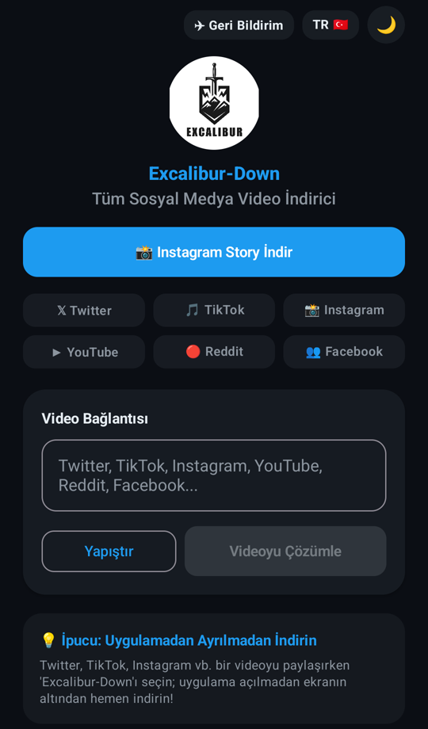
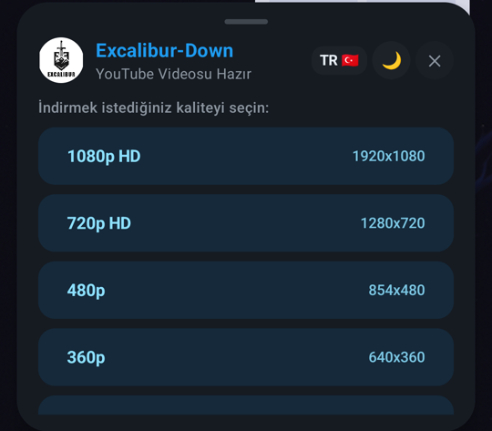
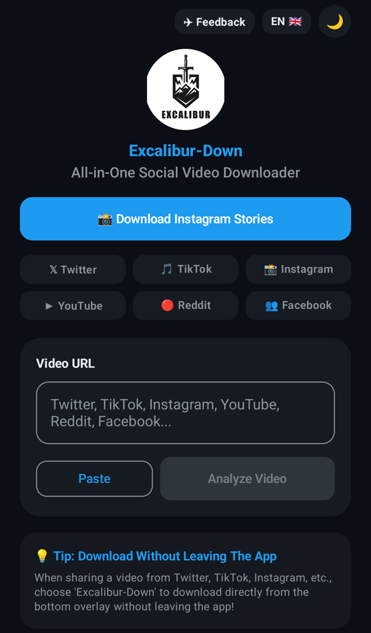
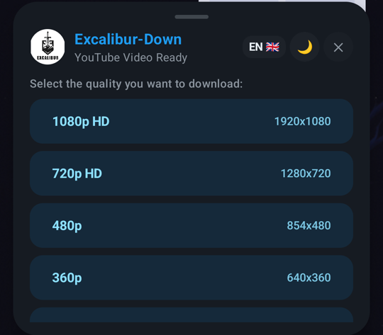
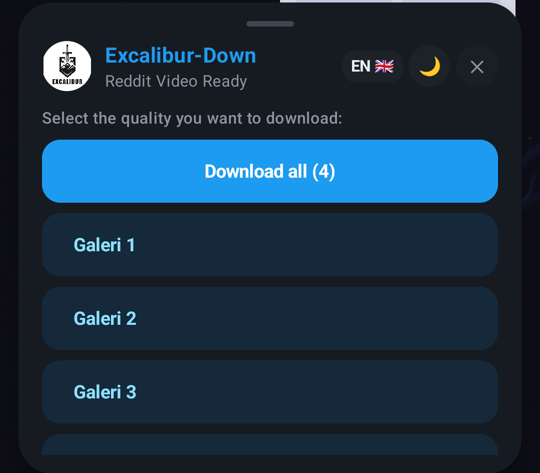

# Excalibur-Down

**Tüm sosyal medya video indiricisi · All-in-one social video downloader**

### [⬇️ APK İndir / Download APK](https://github.com/uumitaydinn/excalibur-down/releases/latest/download/Excalibur-Down.apk)

[🇹🇷 Türkçe](#-türkçe) · [🇬🇧 English](#-english)

---

## 🇹🇷 Türkçe

Excalibur-Down; YouTube, Instagram, TikTok, X (Twitter), Reddit ve Facebook'taki videoları, fotoğrafları ve GIF'leri telefonunuza kaydetmenin en kısa yoludur. Uygulamayı açmanıza bile gerek yok: herhangi bir uygulamada **Paylaş → Excalibur-Down**'a dokunun, kaliteyi seçin, indirme başlasın.

  
  &nbsp;
  
  &nbsp;
  

### ✨ Özellikler

| | |
|---|---|
| ⚡ **Paylaş ve indir** | Uygulamadan çıkmadan, ekranın altında açılan pencereden tek dokunuşla indirin. |
| 🎬 **1080p'ye kadar kalite** | YouTube videolarını 1080p, 720p, 480p, 360p veya yalnızca ses (M4A) olarak kaydedin. Görüntü ve ses telefonda otomatik birleştirilir. |
| 🖼️ **Fotoğraf, GIF ve galeri** | Çok fotoğraflı gönderilerde her görseli tek tek ya da **Tümünü İndir** ile hepsini birden kaydedin. |
| 📸 **Instagram hikayeleri** | Instagram hesabınızla bir kez giriş yapın; hikayeleri ve öne çıkanları indirin. Oturum bilgileri yalnızca cihazınızda saklanır. |
| 🗂️ **Düzenli klasörler** | Videolar `Movies/Excalibur-Down`, fotoğraflar `Pictures/Excalibur-Down` klasörüne kaydedilir ve galeride hemen görünür. |
| 🌙 **Koyu / açık tema, TR / EN** | Tek dokunuşla tema ve dil değiştirin. |
| 🔄 **Otomatik güncelleme** | Yeni sürüm çıktığında uygulama sizi bilgilendirir ve güncellemeyi kendisi indirir. |

### 🌐 Desteklenen platformlar

| Platform | Video | Fotoğraf | GIF | Not |
|---|:---:|:---:|:---:|---|
| YouTube / Shorts | ✅ | — | — | 1080p'ye kadar, ayrıca M4A ses |
| Instagram | ✅ | ✅ | — | Reels, gönderi, carousel; hikayeler için giriş gerekir |
| TikTok | ✅ | — | — | Filigransız seçenek |
| X (Twitter) | ✅ | — | ✅ | |
| Reddit | ✅ | ✅ | ✅ | Galeriler dahil |
| Facebook | ✅ | — | — | Herkese açık videolar |

### 📲 Kurulum

1. Bu sayfadaki **[APK İndir](https://github.com/uumitaydinn/excalibur-down/releases/latest/download/Excalibur-Down.apk)** bağlantısına dokunun.
2. İndirilen `Excalibur-Down.apk` dosyasını açın.
3. Android sorarsa **"Bu kaynaktan yüklemeye izin ver"** seçeneğini açın ve **Yükle**'ye dokunun.

> **1.1.0'dan önceki bir sürümü kullanıyorsanız:** Bu sürüm yeni bir imza anahtarıyla yayınlandı. Kurmadan önce eski uygulamayı bir kez kaldırın. Sonraki güncellemeler kaldırma gerektirmez.

### 🚀 Kullanım

- **Paylaşarak (önerilen):** YouTube, Instagram, TikTok vb. uygulamada **Paylaş** menüsünü açın → **Excalibur-Down**'ı seçin → kaliteyi seçin.
- **Bağlantı yapıştırarak:** Uygulamayı açın → **Yapıştır** → **Videoyu Çözümle** → kaliteyi seçin.
- **Instagram hikayeleri:** Ana ekranda **Instagram Story İndir**'e dokunun ve bir kez giriş yapın. Giriş ekranında **"Log in"** bağlantısına dokunun.

İndirme ilerlemesi bildirimde görünür; tamamlandığında bildirime dokunarak dosyayı açabilirsiniz.

### ❓ Sık sorulan sorular

<b>Uygulama neden Google Play'de yok?</b>

Google Play, bu türdeki indirme uygulamalarına izin vermiyor. Excalibur-Down yalnızca bu sayfadan dağıtılır. Başka sitelerdeki kopyalara güvenmeyin.

<b>"Güncelleme gerekli" ekranı çıkıyor.</b>

Yeni bir sürüm yayınlandı. **Güncelle**'ye dokunun; ilk seferde Android bilinmeyen kaynaklardan yükleme izni ister. İzni verip tekrar **Güncelle**'ye dokunun.

<b>İndirme başarısız oldu.</b>

Bildirimdeki hata metninin ekran görüntüsünü ve paylaştığınız bağlantıyı aşağıdaki geri bildirim kanalından gönderin.

### 💬 Geri bildirim

Hata bildirimi ve istekler için uygulamadaki **✈ Geri Bildirim** düğmesini kullanın ya da Telegram'dan yazın: **[@aaydinnaydinn](https://t.me/aaydinnaydinn)**

### 🔒 Gizlilik

Uygulama günde en fazla bir kez **anonim** bir kullanım sinyali gönderir: uygulama adı, sürüm ve cihazda rastgele üretilen bir kimlik. Ad, e-posta, telefon numarası, konum veya indirdiğiniz içerikler **toplanmaz**. Instagram oturum bilgileri yalnızca cihazınızda saklanır.

### ⚖️ Yasal uyarı

Excalibur-Down yalnızca kişisel kullanım içindir. Yalnızca indirme hakkına sahip olduğunuz içerikleri indirin ve ilgili platformların kullanım koşullarına uyun. Excalibur-Down; YouTube, Instagram, TikTok, X, Reddit veya Facebook ile bağlantılı değildir ve bu şirketler tarafından onaylanmamıştır.

---

## 🇬🇧 English

Excalibur-Down is the quickest way to save videos, photos and GIFs from YouTube, Instagram, TikTok, X (Twitter), Reddit and Facebook to your phone. You don't even need to open it: tap **Share → Excalibur-Down** in any app, pick a quality, and the download starts.

  
  &nbsp;
  
  &nbsp;
  

### ✨ Features

| | |
|---|---|
| ⚡ **Share to download** | Download in one tap from a sheet at the bottom of the screen, without leaving the app you're in. |
| 🎬 **Up to 1080p** | Save YouTube videos in 1080p, 720p, 480p, 360p or audio only (M4A). Video and audio are merged on the phone automatically. |
| 🖼️ **Photos, GIFs and galleries** | Save each image of a multi-photo post on its own, or all of them with **Download all**. |
| 📸 **Instagram stories** | Sign in to Instagram once to download stories and highlights. Your session stays on your device only. |
| 🗂️ **Tidy folders** | Videos go to `Movies/Excalibur-Down`, photos to `Pictures/Excalibur-Down`, and show up in your gallery right away. |
| 🌙 **Dark / light theme, TR / EN** | Switch theme and language with one tap. |
| 🔄 **Automatic updates** | When a new version is out, the app tells you and downloads the update itself. |

### 🌐 Supported platforms

| Platform | Video | Photo | GIF | Notes |
|---|:---:|:---:|:---:|---|
| YouTube / Shorts | ✅ | — | — | Up to 1080p, plus M4A audio |
| Instagram | ✅ | ✅ | — | Reels, posts, carousels; stories need sign-in |
| TikTok | ✅ | — | — | No-watermark option |
| X (Twitter) | ✅ | — | ✅ | |
| Reddit | ✅ | ✅ | ✅ | Galleries included |
| Facebook | ✅ | — | — | Public videos |

### 📲 Install

1. Tap **[Download APK](https://github.com/uumitaydinn/excalibur-down/releases/latest/download/Excalibur-Down.apk)** on this page.
2. Open the downloaded `Excalibur-Down.apk`.
3. If Android asks, turn on **"Allow from this source"**, then tap **Install**.

> **Coming from a version older than 1.1.0?** This release is signed with a new key. Uninstall the old app once before installing. Later updates won't need this.

### 🚀 How to use

- **Share (recommended):** In YouTube, Instagram, TikTok, etc. open the **Share** menu → choose **Excalibur-Down** → pick a quality.
- **Paste a link:** Open the app → **Paste** → **Analyze Video** → pick a quality.
- **Instagram stories:** Tap **Download Instagram Stories** on the home screen and sign in once. On the sign-in screen, tap the **"Log in"** link.

Progress is shown in a notification; tap it when finished to open the file.

### ❓ FAQ

<b>Why isn't it on Google Play?</b>

Google Play doesn't allow downloader apps of this kind. Excalibur-Down is distributed only from this page. Don't trust copies on other sites.

<b>I see an "Update required" screen.</b>

A new version is out. Tap **Update**; the first time, Android asks for permission to install from unknown sources. Grant it, then tap **Update** again.

<b>A download failed.</b>

Send a screenshot of the error in the notification, together with the link you shared, through the feedback channel below.

### 💬 Feedback

For bug reports and requests, use the **✈ Feedback** button in the app or message on Telegram: **[@aaydinnaydinn](https://t.me/aaydinnaydinn)**

### 🔒 Privacy

At most once a day the app sends an **anonymous** usage signal: the app name, its version and a random ID generated on the device. Your name, email, phone number, location and the content you download are **not** collected. Instagram session data stays on your device only.

### ⚖️ Disclaimer

Excalibur-Down is for personal use only. Download only content you have the right to download, and follow each platform's terms of service. Excalibur-Down is not affiliated with or endorsed by YouTube, Instagram, TikTok, X, Reddit or Facebook.
